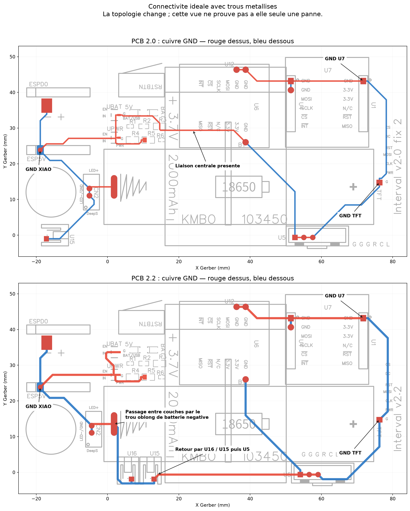
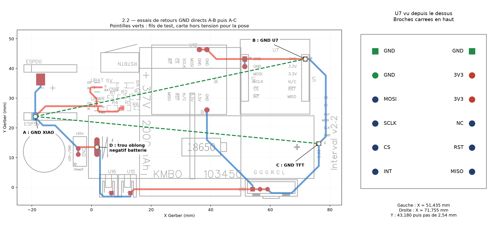

# Interval Footswitch Architecture

## Purpose and reference state

This document is the project's architectural reference: structure, responsibilities, patterns, and extension procedures. Requested work, hypotheses to test, and validation criteria are tracked in [the roadmap](roadmap.md). Contribution instructions are in [AGENT.md](../AGENT.md).

Consolidated on October 29, 2026 from the firmware on `main`, the external
Interval framework, and the PCB audit revised on October 22. Historical audit
findings are dated and do not replace the current code state. This document is
maintained in English.

## 1. Structure and responsibilities

| Location | Responsibility |
|---|---|
| `src/main.cpp` | Selects the diagnostic or mixer application and provides the product `setup()/loop()` entry points |
| `Diagnose` from Interval | Minimal shared-hardware diagnostic mode, selected explicitly |
| `infrafast/Interval` (versioned PlatformIO dependency) | Framework integration, utilities, events, configuration, and common resources |
| `APPManager.h`, `Banks.h` | Application orchestration and bank organization |
| `HWManager.h`, `HWComponents.h` | Power rail, buttons, battery, network, display, USB modes, and shutdown |
| `GUIManager.h`, `GUIComponents.h` | Local interface composition and rendering |
| `Interfaces.h`, `interfaces/` | Device contracts and transports |
| `DataManagement.h` | Addresses, datasets, repositories, and parameter serialization |
| `Strips.h`, `strips/` | Strip models, factory, and reusable implementations |
| `src/mixers/` | Mixer abstraction, adapters, shared values, and domain-specific strips |
| `data/webapp/` | Compressed web resources, translations, and message libraries |
| `platformio.ini`, root Python scripts | Builds, TFT configuration, and update preparation |

Framework implementation details and contracts are documented in the external
[Interval architecture reference](https://github.com/infrafast/Interval/blob/main/docs/architecture.md).
Names without a path in this table refer to the corresponding file in that
repository; names under `src/` refer to this firmware repository.

## 2. Application lifecycle

`setup()` creates `MixingStation` and `XMSeries`, registers the `input2mixbus` and `inputGain` skeletons, then calls `app.init()`. `loop()` calls `app.refresh()`.

New features must integrate with this lifecycle: declarative setup at startup, bounded periodic processing in monitoring methods, and events. Do not add a blocking network wait loop to routine processing.

Hardware has its own lifecycle: power rail activation, display and component initialization, LittleFS mounting, USB mode selection, then monitoring. Shutdown also changes pin levels before switching off the rail; tests must cover cold startup and wake-up after software shutdown.

### Current TFT / W5500 order

The firmware uses the historical initialization order: the peripheral rail is
enabled, components are initialized (including Ethernet), and the TFT is then
initialized. 

The TFT and W5500 reset line remains shared. Hardware startup reliability is
being investigated separately on PCB revision 2.2; no software initialization
order change should be assumed to fix that electrical issue.

## 3. Patterns and contracts

### Interfaces and adapters

`DeviceInterface` combines `SerializableParameters`, `EventDispatcher`, and `EventListener`. Its instances register in `interfaceRepo`. The contract includes `begin()`, `end()`, `monitor()`, property serialization/restoration, and state transitions. The `_begin()` and `update()` functions implement part of the common lifecycle: preserve their behavior when overriding them.

#### State transition and state projection rule

Interface workflows own business transitions. Methods such as `enable()`, `disable()`, connection/disconnection handlers, discovery methods, and event handlers decide whether a service starts, stops, reserves/releases capacity, or changes network ownership. They then call `setStateXXX()` to publish the resulting state through the framework.

`setStateXXX()` methods are state-projection helpers: they update the framework-visible fields (`code`, `label`, `subState`, `details`, `progress`, `led`, and broadcast flags) used by the GUI, serializers, QoS handling, and message system. They must not themselves start or stop services, perform discovery, reserve resources, or otherwise initiate business transitions. Keeping side effects in workflow methods prevents a GUI/state refresh from unexpectedly changing runtime behavior.

When extending an interface, follow this order: perform or decide the business transition in the workflow, then call exactly the state helper that describes its result. If a state helper appears to need side effects, move those side effects back to the owning workflow instead of adding lifecycle behavior to `setStateXXX()`.

`NetworkDevice` adds networking, ports, connection events, and presence monitoring. Concrete transports include `NetworkOSC` and `NetworkSocket`. States include ready, disconnected, pending, error, disabled, offline, and syncing; use the existing mechanisms rather than a parallel boolean.

#### Wi-Fi configuration AP and deferred STA activation

`HWManager::network` owns the normal network transport. `HWManager::configMedia`
identifies the medium currently used to expose configuration services. During a
configuration request, `HWManager::startAP()` stops the normal STA attempts,
creates the `AccessPoint`, initializes it in AP-only mode, and assigns it to
`configMedia`. This deliberate AP-only workflow avoids having the AP and STA
objects compete for the shared Wi-Fi state while the user is connected to the
WebGUI.

The WebGUI sends the `setWifi` command with an SSID and password. When
`configMedia` is the dedicated configuration AP, `APPManager` calls
`Network::rememberSSID()` rather than starting a connection. It updates the
in-memory credential list and immediately persists `S_SSID` and
`S_LAST_USED_SSID` through `systemCfg.save()`. The AP and its HTTP session stay
available, and the saved credentials are loaded by `applySystemSettings()` and
used by the STA on the next normal startup. An empty SSID or a failed save is
reported as a command error.

When the normal network itself is the configuration medium, the existing
`Network::setSSID()` path is retained and may attempt an immediate connection;
it also persists the selected credentials. AP+STA simultaneous operation is not
part of this workflow and must be designed and validated separately before it
is enabled.

### Mixer abstraction and template composition

`MixerBase` exposes protocol-independent domain operations, including requests and writes for bus and send levels/mutes. `MixerDevice<NetworkBase>` composes this contract with a transport:

- `MixingStation : MixerDevice<NetworkSocket>`;
- `XMSeries : MixerDevice<NetworkOSC>`.

The template selects the transport at compile time; virtual `MixerBase` methods select the concrete command implementation at runtime. The two inherited parents represent separate responsibilities within one backend object. Beginner-oriented walkthroughs, including a channel-5/bus-2 request and constructor forwarding, are attached to the declarations in `src/mixers/mixer.h`, `m_xmseries.h` and `m_mstation.h`.

The `MixerDevice` constructor explicitly associates its `DeviceInterface*` with its `MixerBase*`. `MixerBase::fromDeviceInterface()` resolves this association. Avoid conversions that assume every interface is a particular concrete mixer.

### Strip factory and behavior composition

`StripSkeleton` describes a type, group, constructor, and property addresses. Its constructor registers it in `stripFactory`. The factory reconstructs instances from their identifier; this identifier is therefore part of the persistent format.

`Strip` provides events, rendering, and common behavior. `OneSelectStrip` and `TwoSelectStrip` add dataset-driven selections. `StripMixerMixin<BaseStripT>` composes a visual strip with mixer logic.

The send hierarchy is `Input2MixbusStrip` → `SendStrip` → `StripMixerMixin<TwoSelectStrip>`. The mixin inherits the selected UI base and the non-visual `StripMixer` helper. It does not inherit a concrete mixer; it borrows access to one through `MixerBase`. Choose `OneSelectStrip` for one selection and `TwoSelectStrip` for two. See the class comments in `src/mixers/s_mixer.h` for the extension steps, refresh hooks and existing initialization/lifetime limitations.

In `s_mixer.h`, visibility triggers value requests and focus triggers configuration requests. Periodic refreshes use `STRIP_REFRESH_VISIBLE` and check the `IF_READY` state. An interface may be assigned after construction or replaced: the mixer binding must be resolved again if it changes.

### Events, datasets, and parameters

The framework uses an observer mechanism (`EventDispatcher/EventListener`) to decouple producers and consumers. A pointer attached to an event does not imply ownership transfer; do not retain it beyond its valid lifetime.

`DataSet` registers its values in a `DataRepository` and unregisters on destruction. `DynamicDataSet` delegates to a `DataProvider`. `SerializableParameters` describes addresses and can create associated configuration datasets. `dataRepo` serves skeletons, among other users; `IFdataRepo` separates interface parameters.

Mixers use `DataSetSynced` and `Synchronizer` to retrieve names and propagate changes to the web application. Maximum capacities in the code must not be confused with those of the detected mixer model. Check conversions between internal indices and protocol addresses, which often start at 1.

### Shared values and lifetimes

The external Interval framework provides the generic `ValueList<T>` reservation
container. It owns individually allocated nodes, keeps object addresses stable
until their final release, and requires a default-constructible `T` with a
mutable `count` member. Callers supply matchers and initializers; the container
has no mixer dependencies.

`src/mixers/values.h` includes `Interval.h` and retains the mixer-specific `OneIndexValue` / `TwoIndexValue` structures and `OneIndexValueList` / `TwoIndexValueList` wrappers, based on reservations. Two strips targeting the same key receive the same object: levels and mutes remain consistent through shared pointers.

Each `reserve(...)` must have a corresponding `unreserve(...)`. The last release destroys the object; any remaining pointer becomes invalid. Release the previous reservation on selection changes and at destruction, initialize pointers, and check null bindings. This describes the required contract: existing strips are not all complete and safe implementations of it.

## 4. Adding a feature

### Reuse-first extension policy and dependency direction

For every change or new feature, first inspect existing framework capabilities, APIs, classes, and extension points. Reuse or compose them if sufficient; otherwise improve or extend the existing abstraction. Introduce a new abstraction only when those options do not fit. Keep the implementation small and maintainable, and make genuinely generic additions reusable without designing for hypothetical needs.

The required dependency direction is application code toward Interval. Generic,
application-independent facilities belong in the external Interval repository;
application-specific behavior stays in user code such as
`src/main.cpp` and `src/mixers/`. Interval must not depend on
concrete application/mixer classes or absorb their domain-specific protocol
rules and configuration. Existing mixer abstractions remain application code
unless a separate justified change extracts a genuinely generic facility.

Prefer object-oriented integration through the established contracts. If
necessary framework integration cannot reasonably be expressed within objects,
put minimal shared declarations, callbacks, or wiring in the corresponding
file in the external Interval repository. Keep actual behavior in the
responsible classes and keep domain-specific wiring in the application; using
framework glue must not reverse the dependency direction.

Prefer the existing file that owns a responsibility: generic extensions go into the appropriate existing Interval file, while domain extensions go into the appropriate existing application file. A new source/header file is justified only by a clear design need, such as a distinct cohesive responsibility or a necessary dependency boundary. Do not create files merely to split a small change, or combine unrelated code merely to reduce file count. Record the reuse assessment and any new-file justification in the open roadmap request; retain lasting design rationale in this architecture and the commit description when the completed request is removed. Additional content documentation files remain prohibited under AGENT.md.

### New strip

1. Describe the request and its criteria in roadmap, indicating whether the backend is already available.
2. Choose `Strip`, `OneSelectStrip`, or `TwoSelectStrip`. For a mixer, reuse `StripMixerMixin`.
3. Define a stable identifier and implement abstract methods: action, property serialization/restoration, focus, visibility, and labels; compose widgets suitable for supported shapes and zoom.
4. Create the constructor callback, then the `StripSkeleton`, and register its addresses in the order expected by the selections. Follow the setup in `src/main.cpp`.
5. For a mixer, implement `getConfig()`, `getValues()`, and increase/decrease/action callbacks through `MixerBase`. Reuse shared values and domain limits/conversions.
6. Preserve the event subscription lifecycle. If `init()` is overridden, inspect the base implementation and preserve its necessary effects.
7. Check creation, save/reload, selection/interface changes, disconnection/reconnection, visibility/focus, graphical shapes, deletion, and consistency between two strips sharing a key.

`Input2MixbusStrip` illustrates requests and setters. `inputGainStrip::setInputGain()` still contains a commented-out implementation: do not copy this skeleton as though it were complete. The generic OSC strip also contains incomplete code that must be examined before reuse.

### New interface or mixer

1. Separate transport from domain logic. Extend `DeviceInterface` or an existing transport; for a mixer, follow `MixerDevice<Transport>`.
2. Choose a stable name and group; expose properties through `Address` and `registerDataSetAddress()`.
3. Implement startup, shutdown, and monitoring; handle network loss, reconnection, and property changes without blocking `app.refresh()`.
4. Define serialization, restoration, states, and events. Preserve subscriptions/unsubscriptions and existing network service budgets.
5. For a mixer, follow `MixerBase`, request/set pairs, name datasets, discovery/identification, and model limits. Reflect writes and responses in shared values.
6. Instantiate the interface in the active application and verify its exposure to web configuration.
7. Validate invalid inputs, index limits, offline operation, synchronization, and compatibility with saved configurations.

### Memory and robustness

Use bounded buffers in parsing/transport paths, check sizes and allocation results, and document object ownership. The code mixes `std::vector`, LinkedList, and dynamic allocations: preserve existing contracts and measure before migrating containers. A general memory redesign is outside this documentation consolidation.

## 5. Builds, dependencies, and resources

The build-option reference is `platformio.ini`: `espressif32@6.4.0`, Arduino, Seeed XIAO ESP32-S3, LittleFS, 115200-baud console.

| Environment | Specifics |
|---|---|
| `dev` | DEBUG, TFT before components, pre/post scripts, and archive generation |
| `prod` | release, PROD=1, USB OTG/TinyUSB with boot CDC disabled, TFT pre-script only |

Build commands: `pio run -e dev` and `pio run -e prod`. The dev build has file side effects and an external destination: inspect scripts before running them. A successful build does not prove hardware operation.

`prescript.py` injects `USER_SETUP_LOADED`, the `ILI9341_2_DRIVER` driver, TFT pins, SPI transactions, and a requested frequency of 48 MHz. Generic TFT_eSPI settings are therefore not the effective reference for this hardware.

Dependencies combine the PlatformIO registry, Git URLs, the versioned Interval
framework, and locally bundled libraries. Some references are pinned; others
are not. The TFT_eSPI copy is owned by Interval and is consumed through that
package; there must not be a second `esp32/lib/TFT_eSPI` copy. Ethernet and
mWebSockets still contain project-local adaptations or settings: do not replace
them blindly. `Interfaces_LEGACY.h` is historical, not the recommended model
for new interfaces. Framework dependency changes are made in the Interval
repository, released with a new tag, and then consumed by updating
`platformio.ini` here.

Production TinyUSB MIDI has a header-name collision on case-insensitive filesystems: the project-owned `include/MIDIUSB.h` shim is intentionally retained for the Arduino-USBMIDI library, while `HWManager` selects the native `ESP32TinyUSB` `MIDIusb` header through an explicit include path. The production build also supplies the ESP32-S3 TinyUSB feature macros required by that dependency; the development build keeps using the existing shim path.

### Web resources and updates

`data/webapp/` mainly contains gzip resources, translations, fonts, and images. `preparefiles.py` and its macOS variant prepare assets. The initial analysis notes a `K:` source path, a Windows helper, calls to Toptal minification services, and workflow execution on import. These portability constraints are tracked in roadmap; editable web source must not be assumed available from compressed files alone.

`gzfw_to_data.py` compresses firmware into `data/`. `make_tgz.py` uses version `_V`, archives `data/`, and moves the archive and compressed firmware to a `fwupdate/` folder beside the `esp32` checkout (override with `FWUPDATE_DEST`). The dev build therefore couples compilation and deployment preparation. The prod build does not trigger these two post-scripts.

Framework constants specify `infrafast.fr`, `/fwupdate/`, `/webapp`, and the `.tgz` extension. Do not infer HTTP/TLS behavior from these names alone.

### Internationalization (i18n)

The firmware GUI and the web client use separate catalogues with a defined
boundary:

- `data/*.lang` are the catalogues for the ESP firmware GUI, including the TFT
  menus and firmware-owned interface/status text. They are loaded from LittleFS
  by `I18n`.
- The web client has its own JSON catalogues in the separate webGUI source/deployment tree.
  Those files are not firmware `.lang` files and must not be copied into `data/`
  or translated through the firmware catalogue.
- When the ESP sends a translatable value to the web client, the protocol must
  expose the stable web-catalogue key/identifier; the web client resolves that
  key with its own JSON catalogue. The firmware must not call `lang.getString()`
  for such values and must not place their translations in `data/*.lang`.
  Firmware-owned TFT text continues to use `lang`.
- Web keys such as `hint.artnet` and `hint.directory.no_endpoints` belong in
  the external webGUI checkout (normally `../webGUI/*.json`, or `WEBGUI_SRC`). Every web key must have an English entry and a
  translation in each supported web catalogue, even when the English value is
  different from the key. The firmware sends the key; the browser translates it.
- When a web message carries dynamic data, keep the key separate from the data
  using the established protocol delimiter (for example,
  `hint.directory.discovered|<endpoint list>`). The browser translates the key
  portion and appends the data; the firmware must not build a localized sentence.
- Some webGUI status messages carry runtime data and therefore cannot use a
  complete sentence as their protocol value. They must send a stable key and
  the data after the delimiter (for example,
  `hint.directory.not_detectable|<IP>`). The JSON value contains a `{data}`
  placeholder, which `localizeServerMessage()` replaces in the browser. If a
  key is absent, the browser falls back to the received key/data text; never
  create a catalogue entry for each dynamic value or copy these messages into
  `data/*.lang`.
- `data/*.lang` has the opposite fallback rule: English entries must be omitted
  when the key already supplies the intended English display text, including
  case-only or whitespace-only variants such as `"No Bank": "No bank"`. Keep an
  English entry only when its value adds actual wording beyond the key, while
  every non-English firmware catalogue must contain the required translation.
- `data/webapp/*.json.gz` are generated web-client deployment assets and must be
  rebuilt from the external webGUI sources, never edited directly.

`userLang` is a framework-owned optional extension catalogue. Interval always
instantiates it and loads the matching `.i18n` file when present, both during
startup and after a language-menu change; a missing file leaves the catalogue
empty. User components access this shared object and add/look up their own
keys, rather than instantiating a second global catalogue. Do not create empty
`.i18n` files for languages that have no user-component strings, and do not put
framework or web-client-only strings in them.

The English catalogues have a deliberate compact representation: when an English
translation is identical to its key, the entry must be omitted. `I18n::getString`
and the web translator both fall back to the key itself, so adding redundant
`"KEY":"KEY"` entries increases storage without changing behavior. This rule
applies to both firmware `.lang` files and external webGUI JSON files. English
entries whose value differs from the key must remain present.

Every non-English catalogue must explicitly contain every key used by the
firmware or the active web application, with a real translation. New keys must
be added to all supported non-English languages and to the English source only
when the value is not exactly the key. Do not hard-code user-visible labels in
the TFT menu or web UI: use the existing lookup path and add the corresponding
catalogue entries.

When changing i18n, validate JSON syntax, verify firmware key coverage across
all `.lang` files, verify active web-key coverage across all language JSON
files, and regenerate/test the compressed assets. Missing optional `*-user.json`
files must not prevent loading the base language catalogue.

The icon fonts follow the same ownership boundary. `data/webapp/interval.ttf.gz`
contains system glyphs used by the framework. `data/webapp/user.ttf.gz` is the
application-owned glyph source; an application interface selects its renderer
and glyph in application code. The mixer application uses it for the Mixing
Station and Behringer/XM interface icons. Do not move application glyphs into
the system icon map unless they become framework features.

High-impact areas are `Interval.h`, `src/mixers/`, `platformio.ini`, and preparation scripts: check their cross-cutting effects before changes.

## 6. PCB 2.0 / 2.2 hardware audit — historical reference

The report below preserves measurements, evidence, and limitations from the October 21 audit, revised on October 22, 2026, against code `58ba13a`. Its initialization timeline is historical: see the current order in section 2. Proposed tests and fixes were moved to roadmap; they are not recorded as completed.

### Audit context

Initial audit dated October 21, 2026, **revised on October 22 after confirmation that the W5500 is soldered on U6, not U7**. Code examined at commit `58ba13a`, with initialization files unchanged between the initial audit and its revision, and the same Gerber archives. No firmware or routing changes were made during that audit.

### Conclusion

**With the W5500 on U6, removal of the central ground connection is the hardware change to test first.** The carrier-board copper path from XIAO GND to the lower U6 GND increases from **69.7 to 127.9 mm**, while SPI traces to U6 change very little. A direct wire to that U6 GND reproduces the function of the connection removed in 2.2 without modifying firmware.

This strengthens the hypothesis of a disturbed or defective ground return, **without proving the cause of failure**: ground traces are wider in 2.2, and the module normally connects its three GND pins internally. Ideal SPI, reset, and power connections remain compatible with the code. Under the historical initialization order, both revisions also share startup-state sensitivity: the W5500 is queried before software first drives the shared reset and display CS.

The reported fault is therefore: W5500 not detected on **U6**, incorrect colors with **the same XIAO and TFT**. Whether the same W5500 module was tested on both PCBs is not established; its condition and solder joints still need checking. The original report's U7 context is replaced by U6 in the calculations, tests, and illustrations below.

### Scope and method

The two ZIP archives contain copper layers, silkscreen, masks, board outline, and drill files. They contain no schematic, bill of materials, component models, or detailed electrical stackup. The TFT and W5500 modules have their own electronics, absent from these files.

The audit decoded both copper layers and reconstructed their geometric connectivity with Gerbonara/Shapely, linking layers through plated holes, **including slots**. SMD pads were evaluated on their own layer: a trace passing underneath on the other layer does not form a connection. Pins were identified using silkscreen and XIAO pinout. A second independent reading confirmed the main connections.

The **27 named connection groups** compared are identical; their inventory is preserved in [connexions-verifiees.json](audit-pcb-2.0-2.2/connexions-verifiees.json). This covers explicitly identified audit points, not a complete netlist of the assembled product.

The U6 revision reconstructs critical connectivity and paths again from both ZIP archives. The [analyse_gerbers.py](audit-pcb-2.0-2.2/analyse_gerbers.py) script regenerates illustrations and [mesures-u6.json](audit-pcb-2.0-2.2/mesures-u6.json), including archive SHA-256 hashes. A second model ideally connects U6's three GND pins to distinguish carrier-only paths from those enabled by the module; it models neither internal resistance nor inductance.

This is a connectivity check and reconstruction of software timing, **not a SPICE simulation or board measurement**. Connectivity assumes manufacturing matches the Gerbers; it does not prove solder, plating, or assembled component quality.

### 6.1. What the code requires

Effective configuration is injected by [prescript.py](../prescript.py). Because of `USER_SETUP_LOADED`, generic TFT_eSPI configuration does not determine these pins.

| Signal | XIAO | GPIO | Destination | 2.0 / 2.2 comparison |
|---|---|---:|---|---|
| Peripheral rail enable | D4 | 5 | Switched supply EN, active HIGH | Identical |
| Ethernet CS | D5 | 6 | U6 CS, active LOW; also U7 CS | Identical |
| Display CS | D3 | 4 | TFT CS, active LOW | Identical |
| Display command/data | D6 | 43 | TFT DC | Identical |
| Shared reset | D7 | 44 | TFT RST and W5500 RST | Identical |
| SPI clock | D8 | 7 | TFT CLK and U6 SCLK; also U7 | Identical |
| MOSI | D10 | 9 | TFT MOSI and U6 MOSI; also U7 | Identical |
| MISO | D9 | 8 | U6 MISO; also U7 | Identical |

The depicted TFT connector has seven pins and **does not expose MISO/SDO**. MISO contention must therefore not be attributed to this display without another hardware connection. An undefined display CS can nevertheless cause it to receive unwanted commands.

Checked resistor and analog-input connections are also identical. Initially suspected differences there resulted from crossings between layers.

### 6.2. Virtual execution of historical startup

Main references are [HWManager.h](https://github.com/infrafast/Interval/blob/v0.1.3/src/HWManager.h), [HWComponents.h](https://github.com/infrafast/Interval/blob/v0.1.3/src/HWComponents.h), [w5100.cpp](../lib/Ethernet/src/utility/w5100.cpp), and the TFT_eSPI implementation supplied by the Interval dependency. Line numbers below refer to the historical audited revision.

| Step | Action performed | Hardware consequence |
|---|---|---|
| Construction and button wait | Peripheral rail initially disabled | Peripherals are not yet operating normally |
| `HWManager.h:281` | GPIO5 goes HIGH | Switched power must rise correctly |
| `HWManager.h:285` | Component initialization, networking registered first | W5500 is processed before TFT |
| `HWComponents.h:1290` | `Ethernet.init(GPIO6)`, then `Ethernet.begin(...)` | Prepares Ethernet detection |
| `w5100.cpp:101` | **560 ms** wait, then Ethernet SPI/CS configuration | A substantial delay already exists before initial exchanges |
| Ethernet detection | Software reset and SPI register tests, including `VERSIONR == 4` | Power, ground, and physical reset must already be valid |
| `HWManager.h:287` | `tft.init(1)` finally configures TFT CS and GPIO44 | Hardware determines their states during the first Ethernet attempt |
| `TFT_eSPI.cpp:677` | Reset HIGH 5 ms, LOW **20 ms**, HIGH; **150 ms** wait | W5500 also receives this reset after its first initialization |
| TFT configuration | Pixel-format and memory-control writes, sleep exit; **120 ms** wait | Incorrectly received commands may cause display errors |

The `WiFiEth` hardware-reset implementation exists, but its initial configuration and call are commented out (`HWComponents.h:1257` and `:1288` in the audited revision).

**The 20 ms TFT reset is not too short for W5500**: its specification requires at least 500 µs LOW. Initialization order and states before the first communication are more suspect than insufficient pulse width. The “500 ns” comment in the unused method does not match the specification. [Source: W5500 datasheet, §5.5.1](https://docs.wiznet.io/img/products/w5500/W5500_ds_v110e.pdf).

This weakness exists in both revisions. It therefore does not demonstrate the 2.2 regression. Moreover, the library may retry detection if it has never succeeded; one failed initial detection does not by itself explain a permanent failure.

At shutdown, the firmware places reset in `INPUT_PULLDOWN` and CS lines LOW before cutting power (`HWManager.h:397` in the audited revision). Compare startup after software shutdown with startup after complete power removal.

### 6.3. Actual copper differences

#### Ground return



In 2.0, a central trace directly connects the power-area ground to the lower U6 GND, around `(38.735; 26.035) mm`, then to the right-hand ground network.

In 2.2, this central connection is absent. The return between the XIAO/power area and the right-hand side follows:

`XIAO GND → CN2 → negative battery slotted pad → U16/U15 → U5 → lower U6 GND`.

The lower U6 GND is now at the end of a branch extending from U5 instead of directly connected to the power area. The ground network also extends toward TFT/U7 and the upper U6 GND pins.

The layer transition at the negative battery pad, centered around `(1.831; 13.537) mm`, therefore becomes critical. `Drill_PTH_Through.DRL` does declare it plated. **Missing or defective plating here can disconnect peripheral ground in 2.2**, whereas 2.0 has the central connection. This would be an actual manufacturing defect to check; it is not demonstrated by the ZIP archive.

Neither version has a continuous ground plane beneath SPI. Fast return currents follow distant traces rather than running immediately beneath the signals. Their changed route may alter interference even when a multimeter shows continuity.

#### Lengths and widths: what they establish

Rounded centerline path estimates from copper; these exclude internal module connections, contacts, and packages.

| Path | 2.0 | 2.2 | Interpretation |
|---|---:|---:|---|
| XIAO → U6 CS | 39.9 mm | 39.9 mm | Unchanged |
| XIAO → U6 SCLK | 52.6 mm | 52.8 mm | Nearly unchanged |
| XIAO → U6 MOSI | 58.1 mm | 56.9 mm | Nearly unchanged |
| XIAO → U6 MISO | 39.8 mm | 38.2 mm | Slightly shorter |
| XIAO → U6 RST | 36.1 mm | 35.8 mm | Nearly unchanged |
| Switched supply output → U6 3V3 | 33.0 mm | 36.7 mm | Slightly longer, but wider |
| XIAO → TFT CLK | 108.7 mm | 109.0 mm | Nearly unchanged |
| XIAO → TFT MOSI | 110.7 mm | 110.5 mm | Nearly unchanged |
| XIAO GND → lower U6 GND | **69.7 mm** | **127.9 mm** | **+58.2 mm, approximately +84% on the carrier alone** |
| XIAO GND → upper-left U6 GND | 202.7 mm | 198.9 mm | Carrier alone, before internal module bridges |
| XIAO GND → upper-right U6 GND | 200.1 mm | 196.3 mm | Carrier alone, before internal module bridges |
| XIAO GND → TFT GND | 132.8 mm | 129.0 mm | No overall increase toward the display |

SPI traces remain approximately **0.15 mm** wide. Main power and ground traces increase from approximately **0.40 to 0.60 mm**. An explanation based on narrower power traces would therefore be incorrect.

**Module U6 changes the assembled board's ground network.** Its GND1, GND2, and GND3 are normally common on its own PCB. The two paths over 190 mm in the table are therefore not the only actual paths: the lower GND also provides access to the upper pins through the module. Ideally connecting all three pins in the model leaves the shortest carrier copper path to their common network at 69.7 mm in 2.0 versus 127.9 mm in 2.2. This abstraction does not describe current sharing or SPI-edge behavior; check actual continuity between the module's three GND pins and their solder joints.

An 84% length increase does not imply an 84% increase in effective resistance. For illustration, with equal copper thickness and a uniformly widened path from 0.4 to 0.6 mm, that branch's resistance would increase by only approximately 22%, before parallel paths. This alone is insufficient to explain a major 3.3 V voltage drop. Loop geometry and contact quality remain hypotheses to check.

The library requests 48 MHz for TFT and 14 MHz for Ethernet. With the installed framework's dividers and an 80 MHz APB, expected frequencies are approximately 40 MHz and 13.3 MHz; these are inferred from code and need measurement. At these speeds, edges, ground returns, and branches to unpopulated U7 matter as much as overall length.

The geometric check found no ideal short circuit between identified SPI nets. It does not replace CAD DRC or inspection of the manufactured board.

Tests and proposed fixes are in [the roadmap](roadmap.md).

### 6.4. Measurement points



Coordinates in millimeters in the Gerber reference frame, viewed from above. Square pads indicate orientation; also use silkscreen, especially when turning the board over.

| Point | X | Y |
|---|---:|---:|
| XIAO GND | -18.875 | 23.840 |
| XIAO D7 reset | -6.175 | 23.840 |
| **Lower-right U6 GND — jumper point B** | **38.735** | **26.035** |
| Upper-left U6 GND | 36.195 | 46.355 |
| Upper-right U6 GND | 38.735 | 46.355 |
| U6 3V3, lower row | 33.655 and 36.195 | 26.035 |
| U6 RST, lower row | 28.575 | 26.035 |
| U6 CS, upper row | 28.575 | 46.355 |
| U6 SCLK, upper row | 31.115 | 46.355 |
| U6 MOSI, upper row | 33.655 | 46.355 |
| U6 MISO, lower row | 26.035 | 26.035 |
| TFT GND | 76.280 | 14.729 |
| TFT power | 76.280 | 17.269 |
| TFT CLK | 76.280 | 19.809 |
| TFT MOSI | 76.280 | 22.349 |
| TFT RST | 76.280 | 24.889 |
| TFT DC | 76.280 | 27.429 |
| TFT CS | 76.280 | 29.969 |
| Center of negative battery slot | 1.831 | 13.537 |

### 6.5. Archive traceability

```text
gerber 2.0.zip : 816f48444a10b10940ad6487be7759d7bb7c74b2495aaf69b204603db69626e4
gerber 2.2.zip : e54ce7f20fed21e5af8e3364e44150f06e8e662e9860993b7cdabde0eb5ed2c9
```

Before a definitive CAD correction, the most useful evidence would be results from the first two tests, a power/reset/CS startup capture, and schematics/bills of materials for the modules and supply. These would help turn electrical hypotheses into a targeted correction.

## 7. Generated class reference and diagrams

`Doxyfile` scans this repository's `src/` to produce the firmware class
reference with inheritance and collaboration diagrams rendered by Graphviz.
The external Interval repository owns and generates the framework reference;
the two outputs are intentionally separate. No manually maintained UML model or
new explanatory document is introduced. Third-party libraries and the
alternative test application are excluded. Generated pages are disposable
reference output, not additional maintained working references.

Project-owned C++ under `src/` uses Doxygen file/type/API comments (`@file`,
`@brief`, and contract tags where useful). Framework declarations and their
reference documentation are maintained in the external Interval repository.
Public behavior and non-obvious application algorithms are described beside
their declarations. Implementation notes and disabled examples remain ordinary
comments.

Diagrams are available on individual class pages, with a class list and hierarchy for navigation. UML boxes show public/protected members with a field limit; graph depth and node limits keep large relationships readable. This is static source analysis: runtime event subscriptions, factory registrations, actual object ownership and active screen changes must still be understood from the code and architectural explanations. The parser does not compile firmware or fully resolve every macro/template and build variant. Constructor-style global initializers and template/external base types can appear as synthetic entries; these are parser limitations, not additional application APIs.

For local use, install Doxygen and Graphviz (`dot` must be on PATH), then run `doxygen Doxyfile` from the repository root, or select **Tasks: Run Task → Documentation: generate class diagrams** in VS Code. Open `build/doxygen/html/index.html` in a browser. Regenerate after editing code. The task does not automatically run on every save. Generated output is ignored by Git.

`.github/workflows/documentation.yml` regenerates the reference on relevant pushes to `main`, pull requests, and manual runs. It checks HTML and inheritance/collaboration SVGs in a separate validation step, accepting Doxygen's escaped underscores in graph filenames and reporting missing outputs explicitly. It uses Node.js 24 checkout/artifact actions and uploads available HTML even when validation fails for diagnosis. It uploads a `class-documentation` artifact retained for 14 days. Download and extract it, then open `index.html`. Parser warnings are uploaded separately. No PlatformIO build or firmware packaging/deployment scripts run.

To enable a permanent website, select **Settings → Pages → Build and deployment → Source → GitHub Actions**, then create the repository Actions variable **DOCS_PUBLISH_PAGES** with value **true** under **Settings → Secrets and variables → Actions → Variables**. Run **Actions → Class documentation → Run workflow** once; subsequent relevant pushes publish automatically. The deployment job exposes the actual website URL. Pages availability depends on repository visibility and account plan. Enabling publication exposes the generated class reference and source listings to the audience allowed by the Pages configuration.

`Doxyfile` resolves the bundled Ethernet header path without adding that dependency to the scanned input.

The Doxyfile, Actions workflow and VS Code task are configuration files required by this tooling. Maintained usage explanations remain in this architecture document; generated HTML/SVG output is not committed.
